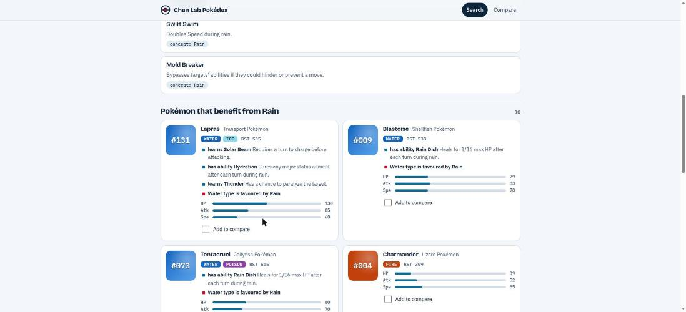

[](https://github.com/josuebrunel/biolevate-assessment-fs-pokedex/actions/workflows/ci.yml)
[](go.mod)
[](docker-compose.yml)
[](https://echo.labstack.com/)
[](https://github.com/josuebrunel/biolevate-assessment-fs-pokedex/commits/main)

# Contents

- [Assessment](#assessment)
  - [Context](#context)
  - [Mission](#mission)
  - [Expected effort](#expected-effort)
  - [Deliverables](#deliverables)
  - [Technical freedom](#technical-freedom)
    - [Use of AI tools](#use-of-ai-tools)
  - [Product expectations](#product-expectations)
    - [Illustrative search challenges](#illustrative-search-challenges)
- [Solution](#solution)
  - [Quick start](#quick-start)
  - [Try these four searches](#try-these-four-searches)
  - [How it works](#how-it-works)
  - [Decisions and relevance policy](#decisions-and-relevance-policy)
  - [Tech stack](#tech-stack)
  - [How it was validated](#how-it-was-validated)
  - [AI use disclosure](#ai-use-disclosure)
  - [Limits and next steps](#limits-and-next-steps)
  - [Reference](#reference)

# Assessment

## Technical Exercise — The Pokédex Search Engine

### Context

Professor Chen leads a growing research lab whose Pokédex has become difficult
to use. It contains information about Pokémon, moves, abilities, types, stats,
and relationships, but finding useful information still requires knowing
exactly where to look and what something is called.

The Pokédex is used by people with different levels of knowledge. An experienced
researcher may look for a specific move, while a new trainer may remember only
part of a name, a characteristic, an effect, or a gameplay intent.
A query may also involve several kinds of entities.

### Mission

**Build a program in which users submit a query
and obtain useful results from the provided Pokémon data.**

The data is available here:
[`pokedex.json`](https://biolevatestatics.blob.core.windows.net/biolevate-tech-assessments/pokedex/pokedex.json).
You may transform or prepare it locally.
You may also supplement it with another data source or optional service,
provided the baseline application remains runnable and reviewable.

Your challenge is not only to display data.
It is to decide which search problems to solve,
what makes a result relevant,
and how to turn those decisions into a coherent product.

### Expected effort

This exercise is designed to take approximately **8–12 hours of focused work**.
This estimate is guidance to help you size your solution, not a monitored time
limit. You will receive a separate calendar deadline, normally about one week.

### Deliverables

Send a **Git repository** link or a **zip archive**.

Your application must **run locally**.

You should **include a write-up** explaining the choices you made,
the limitations of your project and what you would do next.

### Technical freedom

**There is no prescribed technology stack**.
You are free to choose tools that fit your intended experience.
External paid services must be optional
and must have a functional local or free fallback for review.

#### Use of AI tools

**You may use AI-assisted tools**. If you do, include a short disclosure stating:

- which tools you used;
- what you used them for;
- how you reviewed or validated their output.

Use of AI is not evaluated negatively.
You remain responsible for understanding and being able to explain every part of your submission.

### Product expectations

We are interested in your **thinking process** :)

Whatever scope you choose, aim for a product that
helps its intended users make progress
rather than merely exposing raw data.

Prioritise a coherent, understandable,
and validated product within the expected effort
rather than expanding the scope unnecessarily.
A focused product that solves one difficult user need well
can be stronger than a broad collection of unfinished features.

#### Illustrative search challenges

The following situations progress from a focused lookup to broader,
exploratory needs.

1. **Recover something partially remembered.** A new trainer saw a Pokémon
   whose name began with `bulba`, but cannot remember the full name. They want
   to find it quickly and confirm that it is the Pokémon they had in mind.
2. **Find and compare candidates from practical criteria.** A trainer has one
   team slot left and wants a fast Electric-type Pokémon. They need
   useful candidates and enough comparable information to make a choice.
3. **Discover an answer without knowing its vocabulary.** A trainer wants a
   way to put an opponent to sleep, but does not know which moves, abilities,
   or Pokémon can help. They need results that make the relevant relationship
   understandable.
4. **Explore a strategy spanning connected information.** An experienced
   trainer is building a rain-oriented team. They want to discover ways to
   take advantage of rain, Pokémon that benefit from it, and useful related
   options, without searching each category separately.

These are product situations, not an exhaustive acceptance test or a required
feature list. Your application does not need to solve all four.

# Solution

**A search engine for the Kanto Pokédex that understands what you mean and tells you why each result is there.** Type half a name, a team need, an effect or a strategy, and get Pokémon, moves and abilities grouped, ranked and explained. **One command to run, works offline, Postgres only.**



**Deep dives** (schema, query plan, ranking, concept map, hardening) live in **[docs/design.md](docs/design.md)**, and **example queries** in **[docs/queries.md](docs/queries.md)**. This page is meant to be read in five minutes.

## Quick start

**You need Docker with the Compose plugin. Nothing else** (no Go, Node or Postgres install).

```sh
docker compose up --build
```

Open **http://localhost:8080**. This starts Postgres, applies the migrations, imports the dataset (embedded and checked against its SHA-256) and serves the app. The first build needs the network once; after that it runs offline.

If a port is taken, use `DB_PORT=5433 APP_PORT=8081 docker compose up --build`.

<details>
<summary>Develop and test without Docker for the app</summary>

Needs Go 1.27 and `make` (plus `templ` to edit views and `golangci-lint` for `make lint`).

```sh
docker compose up -d --wait db      # only the database
make migrate-up import run          # run the app
make test-integration               # every test, against the compose database
make eval                           # print the golden-query report
```

With `DB_PORT=5433` set, `make` targets use that port too. `make test` alone skips the tests that need Postgres.

</details>

## Try these four searches

They are the four situations from the brief. Type them, or click the examples on the home page.

| Situation | Try | What you get |
|---|---|---|
| Partly remembered name | **`bulba`** | Bulbasaur first, with type, genus and stats to confirm. Typos work too (`pikchu`). |
| Fast Electric candidates | **`fast electric`** | Electric types by speed. **Add to party**, then **Battle** for a side-by-side table with the best value per row and a winner. |
| An effect, without the vocabulary | **`put opponent to sleep`** | The moves that cause sleep, then the Pokémon that learn them, **each with the sentence that links it**. |
| A strategy across categories | **`rain team`** | **Tabs** for abilities, moves and Pokémon that work with rain, and why. |

Also works: `chu`, `legendary fire`, `heaviest`, `pokemon with levitate`, `water starter`, `not electric` (or `!electric`), `red pokemon`. More examples, how filters combine and the held-out set: **[docs/queries.md](docs/queries.md)**. Full scope: [design.md](docs/design.md#search-scope-what-it-can-and-cannot-do).

## How it works

`query` → **Parse** → **Retrieve** → **Fuse** → **Expand** → **Explain** → results

- **Parse:** rules read the text into types, a stat sort, entity kinds and strategy words. **Deterministic, no model.**
- **Retrieve:** Postgres returns ranked lists for names (prefix, trigram typos), criteria and full-text. A **concept map** turns `asleep` into the data's own words ("puts the target to sleep").
- **Fuse:** reciprocal rank fusion merges the lists **by rank, not raw score**.
- **Expand:** matched moves and abilities lead to the **Pokémon that learn or have them**, kept as evidence.
- **Explain:** every result lists **why it is there**, and the page shows how your query was read.

**A search costs a constant number of queries (about a dozen), and every query must use an index.** Both are enforced by tests. Step-by-step: [design.md](docs/design.md#how-search-works-step-by-step).

## Decisions and relevance policy

**Users:** a new trainer who remembers half a name or an effect, and an experienced one comparing options or building a team. **Both need to trust a result, so every result says why it matched.**

**Scope:** all four situations from the brief. **Left out on purpose:** matchup and evolution questions (the data has no type chart or evolution order) and anything that needs a model at query time.

**What "relevant" means, in priority order:**

1. **Exact and prefix name matches** first: `bulba` must put Bulbasaur on top.
2. **Typos and fragments** (`pikchu`, `chu`) next, at lower weight, so they never outrank a real name.
3. **Concept-expanded text:** phrases that state a cause outrank mere mentions, and status moves get a small boost.
4. **Graph evidence:** a Pokémon linked by several matches outranks one linked by one.
5. **Criteria** (type, stat, size, legendary) filter and sort directly.

## Tech stack

| Piece | Choice | Why |
|---|---|---|
| Web | Go, Echo v5, Templ, HTMX, hand-written CSS | Server-rendered, works without JavaScript, **no Node build, offline**. |
| Database | **Postgres 17** (`pg_trgm`, full-text) | Names, typos, text and relations in **one engine**; the plan guard can prove every query uses an index. |
| Data access | Bob, Goose, `xenv`, `log/slog` | Bound parameters only; migrations on the binary; typed config; structured logs with request IDs. |
| Packaging | Docker Compose, distroless image | **17 MB, non-root**, health probes. |

**No Redis, no embeddings yet, no graph extension.** The reason for each, and why SQLite would be a credible but untried alternative, is in [design.md](docs/design.md#stack-choices-and-what-was-left-out).

## How it was validated

| Check | What it proves |
|---|---|
| **Golden suite** (94 queries) | Expected results within the expected rank; recall and MRR per category. **Written by the engine's author, so it guards regressions; it is not an independent benchmark.** |
| **Index guard** | Every query's plan is checked; **one that would scan a table fails the test**. |
| **Query-count test** | The same number of queries for 2 or 40 results (**no N+1**). |
| **Real-Postgres and end-to-end tests** | Store, importer, migrations, web layer and the four situations, through HTTP and the templates. |
| **Security tests** | Hostile input stays data; a password never reaches the logs. |
| **CI** | Lint, vet, race tests and a smoke job on the real container. |

## AI use disclosure

- **Tool:** Claude Code (Anthropic), as a pair programmer in the terminal, throughout.
- **Used for:** planning and ticketing, Go, SQL, Templ and tests, UI design previews, debugging and drafting this README.
- **Decided by the author:** the stack, Postgres doing the heavy lifting, no Redis, embeddings only if measured, one ticket per step, and approval of the UI direction.
- **Validated by:** tests in CI against real Postgres, the golden suite instead of eyeballing, the plan guard and query-count test for performance claims, and the UI exercised in a real browser.
- **The author remains responsible for understanding and explaining every part.**

## Limits and next steps

**Known limits**

- **Matchups** (`how to beat gyarados`) and **evolutions** are not answered: the data has no type chart or evolution order (it has a family id, unused so far).
- **Paraphrases outside the concept map** fall back to word matching. **Negation** works for types and stat words (`not electric`, `not fast`); anything else is reported as ignored. **`or` between filters** is not understood yet (`fire or flying` behaves like `fire flying`).
- **English only.** Accents are fine (`pikachú`) and French type names work (`feu`, `électrique`), but names, moves and effects are searched in English, and other scripts (`火`) get a note instead of results.
- **Cards confirm a Pokémon with genus, types and stats**, but show no species description or image, and there is no detail page.
- **The hardening** (rate limiting, CSP, timeouts) goes beyond the brief on purpose and is not needed to judge the search.

**Next steps**

1. **Species description on cards, a detail page and evolution families** (from the family id).
2. **Run the held-out queries** listed in [docs/queries.md](docs/queries.md) (written from the dataset, not tuned against) and report the result next to the golden suite. Add `or` between types.
3. **Measure embeddings** (pgvector, a local model, fallback to lexical) against that set; keep them only if they win by enough to justify a service.
4. **A small type chart**, if extra data is allowed.
5. **A pluggable parser** (vocabulary as data, one filter rule for every facet): [proposal](docs/design.md#proposal-a-pluggable-data-driven-parser).

## Reference

| Command | Purpose |
|---|---|
| `make run` | run the server |
| `make generate` | regenerate Templ components after editing `.templ` files |
| `make migrate-up` / `make migrate-down` | apply all / roll back one migration (`-migrate revert` rolls back all) |
| `make import` | load the embedded snapshot into the database |
| `make test` / `make test-integration` | unit tests (Postgres tests skipped) / every test against the compose database |
| `make eval` | print the golden-query report |
| `make lint` | `go vet` and `golangci-lint` |
